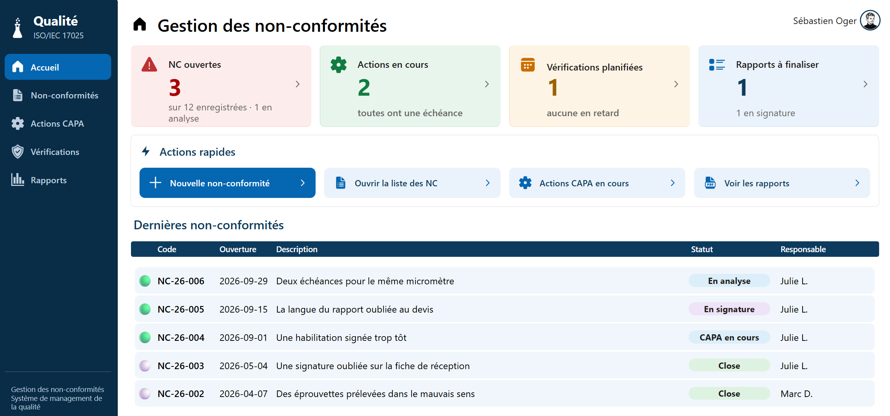
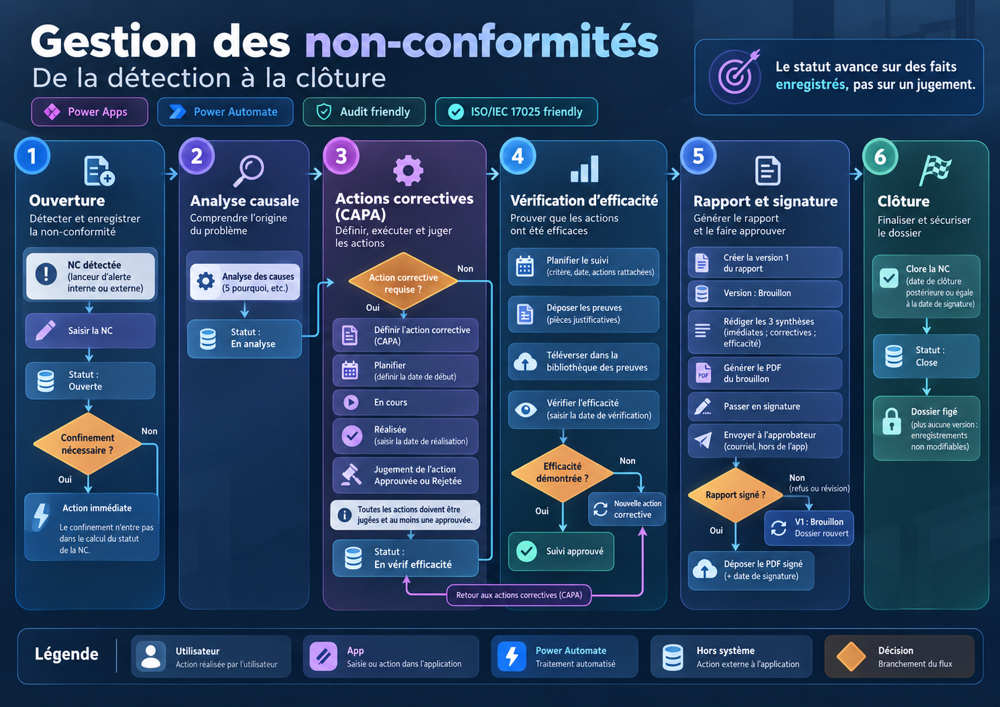

# Gestion des non-conformités — Power Apps, SharePoint, Power Automate

Une application Power Apps qui porte tout le cycle d'une non-conformité (NC) dans un
laboratoire d'essais accrédité ISO/IEC 17025 : déclaration, analyse des causes, actions,
vérification d'efficacité, preuves, rapport PDF, signature et clôture.

Elle remplace le schéma classique « un classeur Excel sur un poste » par une application
partagée, adossée à des listes SharePoint, avec une chaîne documentaire opposable en audit.
Elle n'utilise que des **connecteurs standards** : aucune licence Premium, pas de Dataverse.

Ce dépôt présente le projet : ce que fait l'application, comment elle est construite et
comment elle a été menée. **Le code source de l'application n'y est pas publié.** Toutes les
données montrées sont fictives.

Auteur : Sébastien Oger.



## Ce que fait l'application

| Étape | Ce que l'utilisateur fait | Ce que l'application garantit |
|---|---|---|
| Déclarer | Ouvre une NC, la décrit, désigne un responsable | Numéro attribué automatiquement, jamais renuméroté |
| Analyser | Saisit une ou plusieurs causes racines, avec leurs « 5 pourquoi » | Une NC peut porter plusieurs analyses |
| Agir | Crée des actions immédiates et correctives, y joint des preuves | Les preuves vont dans une bibliothèque du site, pas sur un espace personnel |
| Vérifier | Planifie un suivi d'efficacité et y rattache les actions | Les statuts sont **calculés d'après les faits**, pas saisis |
| Rapporter | Génère le rapport PDF, l'envoie en signature | Chaque version est conservée ; les titres sont figés à la signature |
| Clôturer | Dépose le rapport signé | L'application ne signe rien : elle génère, réceptionne et archive |

Trois écrans de pilotage donnent la vue transversale : actions, vérifications d'efficacité et
rapports.

## Le parcours d'une non-conformité


L'utilisateur agit, le statut suit : il avance sur des faits enregistrés, jamais sur une saisie.



La version de référence de ce parcours est tenue en PlantUML : le
[logigramme](diagrammes/Logigramme-NC.svg) et le [cycle des statuts](diagrammes/Statut-NC.svg),
avec la source de chaque règle dans [diagrammes/](diagrammes/README.md) (version anglaise :
[diagrammes/en/](diagrammes/en/README.md)).

## Architecture

| Brique | Rôle |
|---|---|
| Application canevas Power Apps | 13 écrans, formules Power Fx |
| Site SharePoint | 11 listes et bibliothèques : NC, analyses, actions, suivis, réunions, preuves, rapports, employés, deux référentiels. Elles sont créées par un script PnP PowerShell, qui tient lieu de modèle de données exécutable |
| 3 flux Power Automate | Téléverser une preuve, générer le rapport PDF, déposer le rapport signé |
| Gabarit du rapport | HTML converti en PDF par le flux |

Deux choix structurent le modèle :

- **La NC est le pivot unique.** Chaque analyse, action, suivi, preuve et rapport porte un lien
  direct vers sa NC, parce que Power Fx ne fait pas de jointure.
- **Aucun agrégat stocké.** Un total enregistré finit toujours par diverger : tout est recalculé
  à l'affichage.

## Le jeu de démonstration

L'application est démontrée sur une PME imaginaire d'une vingtaine de personnes, un laboratoire
d'essais sur matériaux métalliques.

- [Douze histoires de non-conformités](jeu-fictif/Douze-Histoires-Non-Conformites.md), de la
  découverte de l'écart à la vérification d'efficacité.
- Le [contrat narratif](jeu-fictif/Contrat-Narratif-Histoires.md) qui a cadré leur écriture, et
  le [référentiel des employés fictifs](jeu-fictif/Referentiel-Employes-Fictifs.md).

## La méthode

Ce projet a été construit avec un agent de programmation, Claude Code. La règle qui en est
sortie : **un contrôle qui partage l'angle mort de ce qu'il contrôle ne contrôle rien, il
confirme.** Quatre garde-fous l'appliquent :

- un garde-fou de compilation compare les fichiers à compiler à l'état synchronisé de
  l'application, et refuse la passe qui ferait disparaître un écran ou un contrôle ;
- un validateur confronte les données au schéma relevé sur le site, avant toute écriture ;
- un script recalcule les statuts par une seconde implémentation, indépendante de celle de
  l'application ;
- un comparateur confronte le PDF généré par le flux à une maquette produite sans aucun code
  partagé.

Le premier est publié ici à titre d'exemple, avec ses 32 tests :
[garde-fous/Garde-Compilation.py](garde-fous/Garde-Compilation.py). L'ensemble du projet en
compte 151.

```
cd garde-fous
python -m unittest test_garde_compilation
```

Deux documents complètent ce tableau :

- la [chronologie du projet](docs/Chronologie.md) : les étapes, ce qui a cassé, ce qui a été
  abandonné ;
- la [charte de design](docs/Charte-Design.md) : les sept règles d'apparence des écrans.

## Limites connues

- Le volet d'analyse de données sous Power BI, prévu au départ, n'a pas été réalisé.
- Le téléversement par le contrôle moderne « Attachments » est suspendu : il n'existait pas
  encore dans l'environnement utilisé.
- Depuis la refonte visuelle, deux des trois flux n'ont pas été rejoués depuis l'application.
  Le détail est dans la [chronologie](docs/Chronologie.md).
