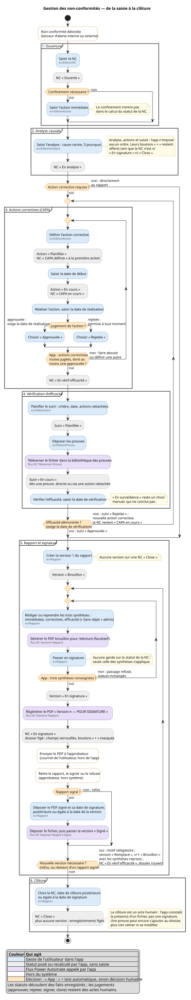
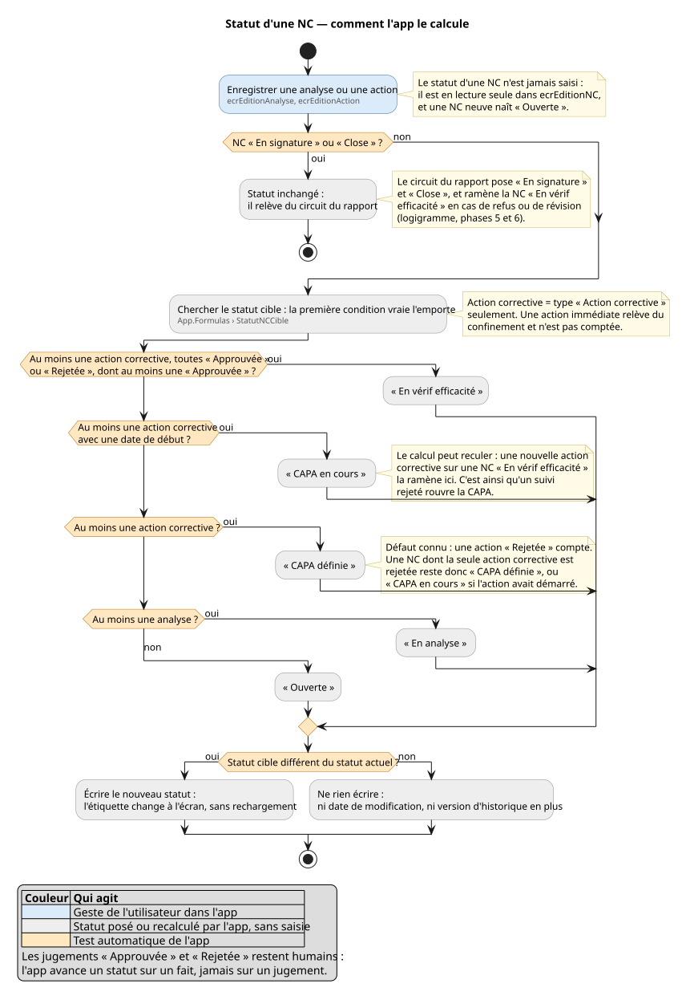

# Diagrammes — gestion des non-conformités

*English version: [en/README.md](en/README.md)*

Deux vues de l'application Power Apps de gestion des non-conformités, écrites en PlantUML. Le
code (`.puml`) fait foi ; le rendu SVG l'accompagne pour qui ne génère rien, GitHub compris, qui
n'affiche pas PlantUML.

| Fichier | Ce qu'il montre |
|---|---|
| [`Logigramme-NC.puml`](Logigramme-NC.puml) | Le parcours d'une NC, de la détection à la clôture : gestes, décisions, statuts, écrans et flux |
| [`Statut-NC.puml`](Statut-NC.puml) | La règle qui calcule le statut d'une NC, avec son ordre de priorité |

## Vue 1 — le logigramme opérationnel et décisionnel



## Vue 2 — le calcul du statut d'une NC



## Lire les diagrammes

| Couleur | Qui agit |
|---|---|
| bleu | geste de l'utilisateur dans l'app |
| gris | statut posé ou recalculé par l'app, sans saisie |
| violet | flux Power Automate appelé par l'app |
| blanc, bord orangé | hors du système : signalement, courriel, signature |
| orangé | décision ; « App : » en tête signale un test automatique, sinon la décision est humaine |

La petite ligne grise sous un libellé nomme l'écran ou le flux qui porte le geste. Les cadres
numérotés sont les six phases du traitement.

Un principe traverse les deux vues : **l'app avance un statut sur un fait, jamais sur un
jugement**. Approuver, rejeter, signer et clore restent des actes humains ; l'app ne signe rien,
et elle constate la présence d'un fichier, pas une signature.

## Générer un diagramme

**Prérequis : PlantUML 1.2023 ou plus récent.** Les couleurs passent par des stéréotypes
(`<<saisie>>`, `<<calcul>>`…) : rendu vérifié le 2026-10-02 avec 1.2023.13 et 1.2026.8, refusé
par 1.2022.7. Ne pas revenir à l'ancienne syntaxe `#couleur:texte;` : dépréciée en 1.2026, elle
y fusionne la boîte avec les lignes suivantes et casse le diagramme. Graphviz n'est pas
nécessaire : les deux vues ont été rendues sans lui.

- **En ligne** — sur [plantuml.com](https://www.plantuml.com/plantuml/uml/), coller tout le
  contenu du fichier `.puml` dans la zone de texte, cliquer **Submit**, puis télécharger le rendu
  par le lien **SVG** ou **PNG**. Le code part alors sur un serveur externe ; il ne porte ni nom
  ni donnée personnelle.
- **Sur le poste, dans PowerShell** — Java et `plantuml.jar` installés dans
  `%LOCALAPPDATA%\Programs`, commande lancée depuis la racine du projet :

  ```powershell
  & "$env:LOCALAPPDATA\Programs\temurin-jre-21\bin\java.exe" -jar "$env:LOCALAPPDATA\Programs\plantuml\plantuml.jar" -charset UTF-8 -tsvg .\diagrammes\Logigramme-NC.puml .\diagrammes\Statut-NC.puml
  ```

  Les SVG s'écrivent à côté des sources ; `-tpng` donne des PNG.
- **Dans VS Code** — extension *PlantUML* (`jebbs.plantuml`). Renseigner le réglage
  `plantuml.java` avec le chemin de `java.exe` ci-dessus, et `plantuml.jar` avec celui de
  `plantuml.jar` : laissé vide, l'extension emploie son propre fichier, d'une version non
  vérifiée ici. Ouvrir le `.puml`, puis **Alt+D** pour l'aperçu.
- **Dans draw.io** — *Arrange > Insert > Advanced > PlantUML*. **Non garanti** : la
  documentation de draw.io présente son PlantUML comme une implémentation partielle de la
  syntaxe, et ces deux vues n'y ont pas été essayées.

## D'où vient chaque règle

Rien n'est tiré d'un processus de NC générique : chaque élément renvoie à une décision de
cadrage ou au code de l'app.

Les documents de conception cités ne sont pas publiés dans ce dépôt.

| Élément des diagrammes | Source |
|---|---|
| Statut de la NC en lecture seule ; une NC neuve naît « Ouverte » | `Spec-Increment-7-Statuts.md`, D2 |
| Cascade du calcul ; action immédiate non comptée ; recul vers « CAPA en cours » | même document, §3.1 ; `canvas/App.pa.yaml`, `StatutNCCible` |
| « En vérif efficacité » : au moins une action corrective, toutes jugées, dont une approuvée | même document, D3 |
| « Approuvée » exige la date de réalisation ; « Rejetée » est permise à tout moment | même document, D4 |
| Suivi « En cours » dès une preuve, directe ou via une action rattachée ; juger un suivi exige la date de vérification ; « En surveillance » reste manuel | même document, D5, D6, §3.3 |
| Le statut ne s'écrit que s'il change | même document, §4 |
| Aucun ordre imposé entre analyse, actions et suivis ; boutons « + » masqués en « En signature » et « Close » | `canvas/ecrDetailNC.pa.yaml`, propriété `Visible` des quatre boutons |
| Dépôt des preuves par flux ; sur une NC verrouillée, l'ajout reste permis, le retrait et la modification non | `Spec-Increment-5-Preuves.md`, §4 et décision B |
| Régénérer un brouillon écrase le PDF de la même version | `Spec-Increment-4-Rapport.md`, décision A |
| Passage en signature : la version, puis le PDF « POUR SIGNATURE », puis la NC ; le dossier se fige | même document, décision B, Q10 et tâche T5 |
| Trois synthèses obligatoires, « Sans objet » admis | même document, décision C |
| Envoi du PDF par l'utilisateur, hors de l'app | même document, décision D |
| Aucune garde sur le statut de la NC au passage en signature | même document, Q8 |
| Refus : version « Remplacé », v+1 « Brouillon », synthèses reprises, NC « En vérif efficacité » | même document, Q1 et Q6 |
| Révision d'un rapport signé, tant que la NC n'est pas close | même document, Q9 |
| Aucune version sur une NC « Close » | même document, Q2 |
| Dépôt du PDF signé par flux ; date de signature postérieure ou égale à la date de la version | même document, §4.1 et critère C9 |
| Clôture avec une date postérieure ou égale à la date de signature | même document, Q11 |
| La clôture est un acte humain ; l'app constate un fichier, pas une signature | `Modele-donnees.md`, §8.12 |
| Champs figés une fois le dossier verrouillé | `Spec-Edition-Enregistrements.md`, §6 |

## Ce que les diagrammes ne montrent pas

- le statut « Migré » des rapports repris de l'historique, jamais passés par le circuit ;
- les revues de suivi (`Reunions`), hors du périmètre de l'app ;
- les écrans de pilotage (accueil et listes de travail), qui sont des points d'entrée, pas des
  étapes ;
- les transitions dans le temps, comme une échéance atteinte : aucun flux planifié ne les porte ;
- l'envoi de courriels par l'app : il n'y en a pas.

## Point ouvert

La Vue 2 signale un défaut connu : `StatutNCCible` compte une action corrective « Rejetée ».
Une NC dont la seule action corrective est rejetée reste donc « CAPA définie », ou « CAPA en
cours » si l'action avait démarré. Les diagrammes documentent ce comportement tel qu'il est.
