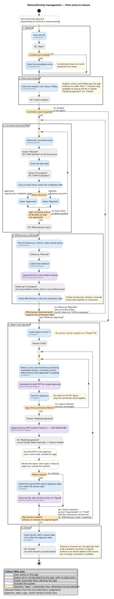
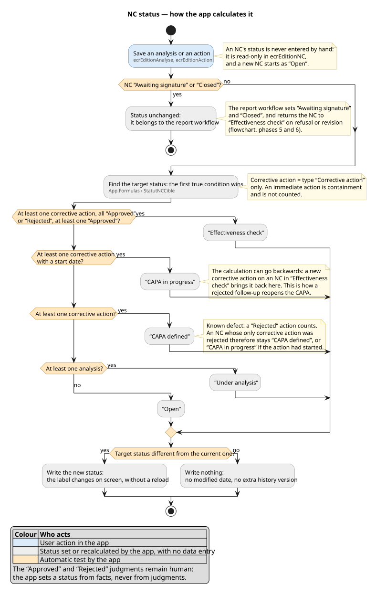

# Diagrams — nonconformity management

*Version française : [../README.md](../README.md)*

Two views of the Power Apps nonconformity (NC) management app, written in PlantUML. The code
(`.puml`) is the reference; the SVG rendering comes with it for readers who generate nothing,
GitHub included, which does not display PlantUML.

| File | What it shows |
|---|---|
| [`NC-Flowchart.puml`](NC-Flowchart.puml) | The path of an NC from detection to closure: actions, decisions, statuses, screens and flows |
| [`NC-Status.puml`](NC-Status.puml) | The rule that calculates an NC's status, with its order of priority |

They are the English versions of [`Logigramme-NC.puml`](../Logigramme-NC.puml) and
[`Statut-NC.puml`](../Statut-NC.puml), with the same structure: any change goes into both
languages.

## View 1 — operational and decision flowchart



## View 2 — how an NC's status is calculated



## Reading the diagrams

| Colour | Who acts |
|---|---|
| blue | user action in the app |
| grey | status set or recalculated by the app, with no data entry |
| purple | Power Automate flow called by the app |
| white, orange border | outside the system: reporting, email, signature |
| orange | decision; “App:” at the start marks an automatic test, otherwise the decision is human |

The small grey line under a label names the screen or flow behind the action. The numbered
frames are the six phases of the process.

One principle runs through both views: **the app sets a status from facts, never from
judgments**. Approving, rejecting, signing and closing remain human acts; the app signs
nothing, and it sees that a file is present, not that it is signed.

## Glossary — the app's own values

The app's interface and data are in French. The diagrams translate the status values; the app
stores and displays the following ones:

| Entity | In the diagrams | In the app |
|---|---|---|
| NC | Open | `Ouverte` |
| NC | Under analysis | `En analyse` |
| NC | CAPA defined | `CAPA définie` |
| NC | CAPA in progress | `CAPA en cours` |
| NC | Effectiveness check | `En vérif efficacité` |
| NC | Awaiting signature | `En signature` |
| NC | Closed | `Close` |
| Action | Planned · In progress · Approved · Rejected | `Planifiée` · `En cours` · `Approuvée` · `Rejetée` |
| Follow-up | the same four, plus Under monitoring | the same four, plus `En surveillance` |
| Report version | Draft · Awaiting signature · Signed · Superseded | `Brouillon` · `En signature` · `Signé` · `Remplacé` |
| Action type | Immediate action · Corrective action | `Action immédiate` · `Action corrective` |
| Report summary | “Not applicable” | `Sans objet` |
| PDF stamp | “Version n — FOR SIGNATURE” | `Version n — POUR SIGNATURE` |

Screen names (`ecrRapport`…), flow names (`NC-Generer-Rapport`…) and the formula
`StatutNCCible` are identifiers: they are kept as they are.

## Generating a diagram

**Requirement: PlantUML 1.2023 or later.** Colours are applied through stereotypes
(`<<user>>`, `<<auto>>`…): rendering checked on 2026-10-02 with 1.2023.13 and 1.2026.8, refused
by 1.2022.7. Do not go back to the old `#colour:text;` syntax: deprecated in 1.2026, it merges
the box with the following lines there and breaks the diagram. Graphviz is not needed: both
views were rendered without it.

- **Online** — on [plantuml.com](https://www.plantuml.com/plantuml/uml/), paste the whole
  content of the `.puml` file into the text area, click **Submit**, then download the result
  through the **SVG** or **PNG** link. The code then goes to an external server; it carries no
  names and no real data.
- **On the workstation, in PowerShell** — with Java and `plantuml.jar` installed under
  `%LOCALAPPDATA%\Programs`, from the project root:

  ```powershell
  & "$env:LOCALAPPDATA\Programs\temurin-jre-21\bin\java.exe" -jar "$env:LOCALAPPDATA\Programs\plantuml\plantuml.jar" -charset UTF-8 -tsvg .\diagrammes\en\NC-Flowchart.puml .\diagrammes\en\NC-Status.puml
  ```

  The SVG files are written next to the sources; `-tpng` gives PNG files.
- **In VS Code** — *PlantUML* extension (`jebbs.plantuml`). Set `plantuml.java` to the path of
  `java.exe` above, and `plantuml.jar` to the path of `plantuml.jar`: left empty, the extension
  uses its own file, whose version was not checked here. Open the `.puml`, then press **Alt+D**
  for the preview.
- **In draw.io** — *Arrange > Insert > Advanced > PlantUML*. **Not guaranteed**: draw.io's
  documentation describes its PlantUML support as a partial implementation of the syntax, and
  these two views were not tried there.

## Where each rule comes from

Nothing is taken from a generic NC process: each element points to a scoping decision or to the
app's code. The sources are in French.

The design documents cited here are not published in this repository.

| Element of the diagrams | Source |
|---|---|
| NC status read-only; a new NC starts as “Open” | `Spec-Increment-7-Statuts.md`, D2 |
| Calculation cascade; immediate action not counted; return to “CAPA in progress” | same document, §3.1; `canvas/App.pa.yaml`, `StatutNCCible` |
| “Effectiveness check”: at least one corrective action, all decided, at least one approved | same document, D3 |
| “Approved” requires the completion date; “Rejected” is allowed at any time | same document, D4 |
| Follow-up “In progress” once any evidence exists, direct or via a linked action; deciding a follow-up requires the verification date; “Under monitoring” stays manual | same document, D5, D6, §3.3 |
| The status is written only when it changes | same document, §4 |
| No order enforced between analysis, actions and follow-ups; “+” buttons hidden when “Awaiting signature” or “Closed” | `canvas/ecrDetailNC.pa.yaml`, `Visible` property of the four buttons |
| Evidence uploaded by a flow; on a locked NC, adding stays allowed, removing and modifying do not | `Spec-Increment-5-Preuves.md`, §4 and decision B |
| Regenerating a draft overwrites the PDF of the same version | `Spec-Increment-4-Rapport.md`, decision A |
| Sending for signature: the version, then the “FOR SIGNATURE” PDF, then the NC; the record locks | same document, decision B, Q10 and task T5 |
| Three summaries required, “Not applicable” accepted | same document, decision C |
| PDF sent by the user, outside the app | same document, decision D |
| No check on the NC status when sending for signature | same document, Q8 |
| Refusal: version “Superseded”, v+1 “Draft”, summaries carried over, NC “Effectiveness check” | same document, Q1 and Q6 |
| Revision of a signed report, as long as the NC is not closed | same document, Q9 |
| No version on a “Closed” NC | same document, Q2 |
| Signed PDF stored by a flow; signature date on or after the version date | same document, §4.1 and criterion C9 |
| Closure with a date on or after the signature date | same document, Q11 |
| Closure is a human act; the app sees a file, not a signature | `Modele-donnees.md`, §8.12 |
| Fields locked once the record is locked | `Spec-Edition-Enregistrements.md`, §6 |

## What the diagrams do not show

- the “Migrated” status (`Migré`) of reports taken over from the history, which never went
  through the workflow;
- follow-up reviews (`Reunions`), outside the app's scope;
- the monitoring screens (home page and work lists), which are entry points, not steps;
- time-based transitions, such as a due date being reached: no scheduled flow handles them;
- emails sent by the app: there are none.

## Open point

View 2 flags a known defect: `StatutNCCible` counts a “Rejected” corrective action. An NC whose
only corrective action was rejected therefore stays “CAPA defined”, or “CAPA in progress” if the
action had started. The diagrams document this behaviour as it is.
